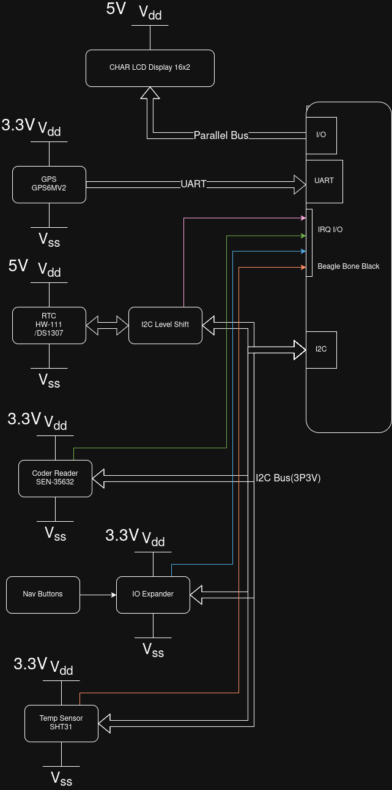

# Overview
Development of a Smart Watch which displays time and alarms. Alarms are set through QR codes read by the SEN_35632 code reader. Buttons for page/menu navigation. GPS diaplay for additional feature of watch. This will be spread bench hardware only.

# Target Build System
using buildroot.

# Hardware Platform

### Using the Beaglebone Black as the base embedded computer module
### Other Hardware Modules:
- GPS P/N: GPS6MV2 
- RTC P/N: HW-111 which uses DS1307 or equivalate DS device
- QR Code Reader P/N: SEN-35632
- IO Expander P/N: MCP23017 which will read menu navigation buttons  
- Temperature Sensor P/N: SHT31 
#### Note: all hardware the team has aquired. 

# Open Source Projects Used
Current plan is not to use any Open Source Projects other than researching ie Google searches about how to do something / set something up.

# Previously Discussed Content
Will be using parts of aesdchar as a template to other drivers for the hardware modules.   
Linux System Programming for system programming reference.
Masterin Embedded Linux Programming for the Beaglebone config.
Linux Device Driver Book Chapter 1- 9.  
Use the buildroot build scripts  

# New Content
### New content that is project will cover is: 
- I2C device driver and application control
- Device driver for I/O to drive the LCD display,  
### Content covered in class but not included in assignments:  
- Blocking code in the kernel waiting on hardware device
- Wall Clock Time???

# Shared Material
N/A no shared Material

# Source Code Organization
Buildroot Repository will be hosted at https://github.com/0xBEE5-ClintFurrer/Final_Project_Buildroot_dev

Clint's Application code will be hosted in in a repository at: https://github.com/cu-ecen-aeld/final-project-0xBEE5-ClintFurrer.git

Ruben's Application code will be hosted in in a repository at: 
git@github.com:cu-ecen-aeld/final-project-rumo3998.git

# Group Overview
The development work will be divided into the following breakout.
### Clint will work:
- Beaglebone Buildroot setup
- RTC Driver and Application Code
- Display Driver
- QR Code Reader 

### Ruben will work:
- QEMU Buildroot setup
- GPS Driver and Application Code
- IO Expander Driver and Application Code 
- Temperature / Humidity Sensor Driver and Application Code

## Team project members:

Clint Furrer - Team Lead  
Ruben Moreno - Team Contributor

# Schedule Page
Link to shared schedule wiki page: 
